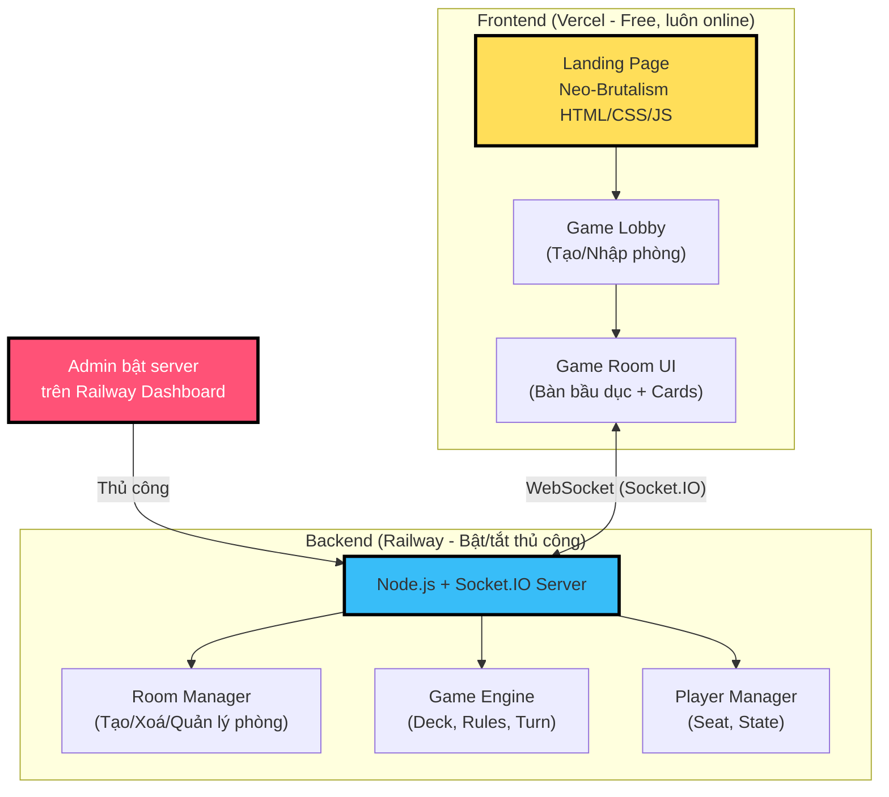
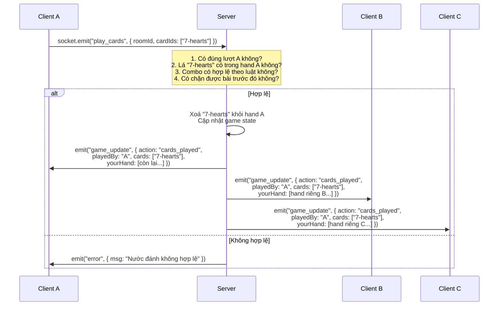

# 🃏 CARDPUNK — Kế Hoạch Thực Thi Chi Tiết

## Tổng Quan Kiến Trúc



### Stack Công Nghệ

| Layer | Công nghệ | Lý do |
|:---|:---|:---|
| **Frontend** | HTML + Vanilla JS + CSS (Neo-Brutalism) | Nhẹ, không cần framework, deploy tĩnh trên Vercel |
| **Game Canvas** | HTML5 Canvas hoặc DOM elements | Vẽ bàn bầu dục, animation xoay vòng, chia bài |
| **Real-time** | Socket.IO (client + server) | Bidirectional, auto-reconnect, room support sẵn |
| **Backend** | Node.js + Express + Socket.IO | Lightweight, event-driven, phù hợp turn-based game |
| **Deploy Frontend** | Vercel (static site) | Miễn phí, CDN toàn cầu |
| **Deploy Backend** | Railway (free tier, bật/tắt thủ công) | WebSocket support, $1 credit/tháng, bật khi chơi - tắt khi xong |

### Nguyên Tắc Kiến Trúc Bắt Buộc: Server-Authoritative (Không Tin Client)

> [!CAUTION]
> **NGUYÊN TẮC SỐ 1: SERVER LÀ NGUỒN SỰ THẬT DUY NHẤT (Single Source of Truth)**
>
> Toàn bộ logic game chạy trên server. Client **KHÔNG BAO GIỜ** được quyết định luật chơi, tính điểm, hay xác định nước đi hợp lệ. Client chỉ là màn hình hiển thị + gửi ý định hành động.

#### Phân vai Server vs Client

| Trách nhiệm | Server (Authoritative) | Client (Dumb Terminal) |
|:---|:---|:---|
| **Quản lý bộ bài** | ✅ Tạo, xáo, chia, lưu trữ deck | ❌ Không biết deck có gì |
| **Bài của player** | ✅ Lưu hand của từng player | ❌ Chỉ nhận bài của chính mình |
| **Validate nước đánh** | ✅ Kiểm tra: đúng lượt? bài thuộc về player? combo hợp lệ? | ❌ Chỉ gửi ý định: "tao muốn đánh lá X" |
| **Tính điểm / Xếp hạng** | ✅ Server tính và broadcast kết quả | ❌ Không tự tính, chỉ hiển thị |
| **Lượt chơi** | ✅ Server quản lý turn order | ❌ Client không thể tự chuyển lượt |
| **Animation / UI** | ❌ Không quan tâm | ✅ Render bàn, bài, hiệu ứng |

#### Flow Mẫu: Player A Đánh Bài



#### Quy Tắc Anti-Cheat Cụ Thể

1. **Client chỉ gửi action intent** — không gửi game state, không gửi điểm số, không gửi bài người khác:
   ```js
   // ✅ ĐÚNG: Client gửi ý định
   socket.emit("play_cards", { roomId: "123456", cardIds: ["7-hearts", "7-spades"] });
   socket.emit("pass_turn", { roomId: "123456" });
   socket.emit("call_sam", { roomId: "123456" });
   
   // ❌ SAI: Client tự gửi state (bị server bỏ qua hoàn toàn)
   socket.emit("update_score", { score: 9999 });       // REJECT
   socket.emit("set_hand", { cards: ["A-spades"...] }); // REJECT
   ```

2. **Server validate 100% trước khi broadcast**:
   - Lá bài có **thuộc về player** đó không? (check `room.hands[playerId]`)
   - Có **đúng lượt** player đó không? (check `room.currentTurn`)
   - Combo bài có **hợp lệ theo luật** game đang chơi không?
   - Nếu là chặn: combo có **đủ mạnh** để chặn không?

3. **Server gửi dữ liệu scoped cho từng player**:
   - Player A nhận: bài của chính mình (ngửa) + số lá bài của B, C (không biết lá gì)
   - Không bao giờ gửi `room.hands[B]` cho player A

4. **Deck hoàn toàn bí mật**: Client không biết thứ tự deck, không biết lá tiếp theo là gì

---

### Dung Lượng Railway Free Tier (Cập nhật mới nhất)

| Thông số | Giới hạn | Ghi chú |
|:---|:---|:---|
| **Giá** | $0/tháng | Sau trial được cấp **$1 credit/tháng** |
| **RAM** | 512 MB / service | Mỗi phòng ~50KB state → dư sức chứa nhiều phòng |
| **CPU** | Tối đa 1 vCPU | Thừa đủ cho game bài turn-based |
| **Volume** | 0.5 GB | Không cần DB, chỉ cần RAM cho game state |
| **$1 credit** | Tính theo phút chạy | Ước tính: ~**500h chạy/tháng** (RAM 512MB + 1 vCPU) |

> [!IMPORTANT]
> **Chiến lược tiết kiệm credit: BẬT/TẮT THỦ CÔNG trên Railway Dashboard**
>
> Vì $1 credit tính theo thời gian service chạy, nếu để server chạy 24/7 cả tháng thì **sẽ hết credit trước cuối tháng**. Giải pháp: chỉ bật server khi muốn chơi, tắt khi chơi xong.

### Quy Trình Vận Hành (Bật/Tắt Thủ Công)

```mermaid
flowchart LR
    A["Muốn chơi game"] --> B["Vào Railway Dashboard"]
    B --> C["Bật service backend"]
    C --> D["Đợi ~10-15 giây khởi động"]
    D --> E["Vào web → Tạo phòng → Chơi"]
    E --> F["Chơi xong"]
    F --> G["Vào Railway Dashboard"]
    G --> H["Tắt service backend"]
    H --> I["Tiết kiệm credit 💰"]

    style A fill:#22c55e,stroke:#000,stroke-width:2px
    style H fill:#ff5277,stroke:#000,stroke-width:2px,color:#fff
```



| Kịch bản sử dụng | Thời gian chạy/tháng | Credit tiêu hao | Đủ không? |
|:---|:---|:---|:---|
| Chơi 2h/ngày × 30 ngày | ~60h | ~$0.12 | ✅ Dư rất nhiều |
| Chơi 4h/ngày × 30 ngày | ~120h | ~$0.24 | ✅ Dư |
| Chơi 8h mỗi cuối tuần × 4 tuần | ~32h | ~$0.06 | ✅ Dư rất nhiều |
| Chạy 24/7 liên tục | ~720h | ~$1.44 | ❌ Hết credit ~ngày 20 |

> [!TIP]
> Với cách bật/tắt thủ công, **$1 credit dư sức chơi thoải mái cả tháng** trừ khi bật liên tục 24/7. Frontend trên Vercel thì **luôn online miễn phí**, nên khi server tắt, trang web vẫn hiển thị bình thường, chỉ là không kết nối được phòng chơi thôi.

### Xử Lý UX Khi Server Offline

Khi backend Railway đang tắt, frontend cần xử lý mượt:
- [ ] **Lobby page**: Khi kết nối Socket.IO thất bại → hiện banner: *"🔴 Server đang tắt. Liên hệ admin bật server để chơi!"*
- [ ] **Auto-retry**: Client tự thử kết nối lại mỗi 5 giây (Socket.IO reconnect có sẵn)
- [ ] **Thông báo online**: Khi server bật lại → banner tự chuyển: *"🟢 Server online! Sẵn sàng chơi."*

---

## Cấu Trúc Thư Mục Dự Kiến

```
d:\CardGame\
├── index.html                    # Landing page (đã có - neo-brutalism)
├── lobby.html                    # Trang chọn game + tạo/nhập phòng
├── game.html                     # Trang chơi game chung (bàn bầu dục)
├── css/
│   ├── global.css                # Design system neo-brutalism
│   ├── lobby.css                 # Lobby styles
│   └── game.css                  # Game table styles
├── js/
│   ├── socket-client.js          # Socket.IO client wrapper (chỉ gửi action intent)
│   ├── lobby.js                  # UI lobby (tạo/nhập phòng)
│   ├── game-table.js             # Render bàn bầu dục, vị trí ngồi
│   ├── card-renderer.js          # Vẽ lá bài (52 lá + Uno + Mèo Nổ)
│   ├── spinner.js                # Animation xoay vòng chọn người/chiều
│   ├── games/
│   │   ├── three-cards.js        # Client UI: 3 lá (chỉ render + gửi action)
│   │   ├── sam.js                # Client UI: Sâm (chỉ render + gửi action)
│   │   ├── tan.js                # Client UI: Đánh Tấn (chỉ render + gửi action)
│   │   ├── uno.js                # Client UI: Uno (chỉ render + gửi action)
│   │   └── exploding-kittens.js  # Client UI: Mèo Nổ (chỉ render + gửi action)
│   └── utils/
│       ├── deck.js               # CHỈ dùng cho render hình lá bài (không xáo/chia)
│       └── animations.js         # Chia bài, lật bài, hiệu ứng
├── assets/
│   ├── cards/                    # Hình lá bài tây (SVG/PNG)
│   ├── uno/                      # Hình lá Uno (official)
│   └── exploding-kittens/        # Hình lá Mèo Nổ (official)
└── server/                         # ⚠️ MỌI LOGIC GAME CHẠY Ở ĐÂY
    ├── package.json
    ├── index.js                  # Entry point (Express + Socket.IO)
    ├── room-manager.js           # Quản lý phòng (tạo, join, leave)
    ├── player-manager.js         # Quản lý chỗ ngồi, trạng thái
    ├── deck-engine.js            # AUTHORITATIVE: tạo, xáo, chia, lưu trữ deck
    ├── games/
    │   ├── three-cards.js        # AUTHORITATIVE: luật 3 lá, tính điểm, xếp hạng
    │   ├── sam.js                # AUTHORITATIVE: luật Sâm, validate combo, bét bảng
    │   ├── tan.js                # AUTHORITATIVE: luật Tấn, attack/defend, bốc bài
    │   ├── uno.js                # AUTHORITATIVE: luật Uno, skip/reverse/+4
    │   └── exploding-kittens.js  # AUTHORITATIVE: luật Mèo Nổ, defuse, nope stack
    └── utils/
        ├── crypto-shuffle.js     # Fisher-Yates + crypto.getRandomValues
        └── validators.js         # Validate: ownership, turn, combo legality
```

---

## Phân Pha Thực Thi

---

### PHASE 1: Core Infrastructure & Game Table UI
**Mục tiêu**: Dựng xong khung sườn frontend + backend, bàn chơi bầu dục, hệ thống phòng, kết nối WebSocket.

**Thời gian ước tính**: 3-4 ngày

#### 1.1 — Backend Skeleton (Server-Authoritative)
- [ ] Khởi tạo Node.js project trong `server/`
- [ ] Setup Express + Socket.IO server
- [ ] **Room Manager**: Tạo phòng (ID 6 số ngẫu nhiên), join phòng, leave phòng, giới hạn số người theo game
- [ ] **Player Manager**: Gán chỗ ngồi clockwise (host = seat 1, join theo thứ tự), theo dõi trạng thái online/offline
- [ ] **Deck Engine**: Tạo bộ bài 52 lá (đảm bảo unique), xáo bài bằng Fisher-Yates + `crypto.getRandomValues()`, chia bài (rút từ deck, xoá khỏi deck), hỗ trợ 1/2/3 bộ bài, validate không trùng lặp
- [ ] **Action Handler Layer** (anti-cheat middleware):
  - Mọi socket event từ client đi qua pipeline: `authenticate → validateTurn → validateAction → execute → broadcastScoped`
  - `validateOwnership(playerId, cardIds)`: Kiểm tra lá bài có thực sự nằm trong `room.hands[playerId]` không
  - `validateTurn(playerId)`: Kiểm tra có đúng lượt player đó không
  - `broadcastScoped(room)`: Gửi state cho từng player riêng biệt — mỗi player chỉ nhận bài của mình, chỉ nhận số lá bài (không biết lá gì) của người khác
- [ ] **Event Contract chuẩn** (client chỉ được emit các event sau):
  ```
  play_cards    → { roomId, cardIds[] }           // Đánh bài
  pass_turn     → { roomId }                      // Bỏ lượt
  call_sam      → { roomId }                      // Báo sâm
  challenge     → { roomId }                      // Nút "Máy Sai"
  draw_card     → { roomId }                      // Bốc bài
  pick_up       → { roomId }                      // Lên bài (Đánh Tấn)
  pile_on       → { roomId, cardIds[] }           // Bồi công
  call_uno      → { roomId }                      // Hô UNO
  choose_color  → { roomId, color }               // Chọn màu (Uno Wild)
  defuse_place  → { roomId, position }            // Nhét Mèo Nổ vào deck
  use_nope      → { roomId }                      // Dùng Nope (Mèo Nổ)
  ```
  Mọi event khác bị **reject và log** để phát hiện cheat attempt

#### 1.2 — Frontend: Lobby Page
- [ ] `lobby.html` + `lobby.css`: Giao diện chọn game (Bài Tây / Uno / Mèo Nổ)
- [ ] Form tạo phòng: chọn game → chọn mode → số người → tạo → nhận Room ID
- [ ] Form nhập Room ID (6 số) để join phòng
- [ ] Kết nối Socket.IO client, sync trạng thái phòng

#### 1.3 — Frontend: Game Table (Bàn Bầu Dục)
- [ ] `game.html` + `game.css`: Canvas/DOM bàn bầu dục xanh (felt texture)
- [ ] **Hệ thống chỗ ngồi**: Render vị trí người chơi quanh bàn bầu dục, user luôn ở vị trí 3h (phải giữa), các player khác xếp clockwise đúng thứ tự ngồi từ góc nhìn user
- [ ] Hiển thị avatar/tên player ở mỗi vị trí, bài úp (mặt sau) cho người khác, bài ngửa cho chính mình
- [ ] Room ID luôn hiện ở góc màn hình
- [ ] **Spinner Animation**: Vòng xoay chọn người bắt đầu (quay → dừng dần → chỉ vào player), vòng xoay chọn chiều chơi (CW / CCW)

#### 1.4 — Card Renderer
- [ ] Component vẽ lá bài tây 52 lá (rank + suit + màu sắc), style neo-brutalism
- [ ] Animation: chia bài (bài bay từ deck → tay player), lật bài, đánh bài ra bàn
- [ ] Bài trong tay user: có thể kéo/chọn để đánh

> [!IMPORTANT]
> **Deliverable Phase 1**: Có thể tạo phòng → join phòng → thấy bàn bầu dục → thấy player ngồi đúng chỗ → spinner quay chọn người → chia bài demo (chưa có luật chơi).

---

### PHASE 2: Game Engine — Bài Tây: 3 Lá
**Mục tiêu**: Implement game đơn giản nhất trước để test toàn bộ pipeline.

**Thời gian ước tính**: 1-2 ngày

- [ ] **Server** (`server/games/three-cards.js`):
  - Chia 3 lá ngẫu nhiên cho mỗi player từ deck
  - Tính điểm: A=1, 2-10 theo mặt, J=11, Q=12, K=13
  - So sánh tổng điểm → xác định người thắng
  - Broadcast kết quả (lật bài tất cả)
- [ ] **Client** (`js/games/three-cards.js`):
  - Hiển thị 3 lá bài trên tay
  - Animation lật bài khi kết thúc
  - Hiển thị bảng xếp hạng kết quả

> [!TIP]
> Game 3 lá cực đơn giản, dùng để **test end-to-end**: tạo phòng → join → spinner → chia bài → kết quả. Nếu chạy mượt thì pipeline sẵn sàng cho các game phức tạp hơn.

---

### PHASE 3: Game Engine — Sâm (Tiến Lên Miền Nam Biến Thể)
**Mục tiêu**: Implement game phức tạp nhất trong nhóm Bài Tây.

**Thời gian ước tính**: 5-7 ngày

#### 3.1 — Core Sâm Logic (Server)
- [ ] Chia 10 lá ngẫu nhiên cho mỗi player
- [ ] **Hệ thống thứ tự bài**: 3 (bé nhất) < 4 < ... < K < A < 2 (lớn nhất), không phân biệt chất
- [ ] **Validate combo hợp lệ**:
  - Lẻ (1 con), Đôi (2 con cùng số), Tam (3 con), Tứ (4 con)
  - Sảnh (dây): ≥3 con liên tiếp (VD: 3-4-5, J-Q-K-A), không cần cùng chất
  - Sảnh đặc biệt: 2-3-4-5 hợp lệ nhưng bé hơn 3-4-5-6. Không có Q-K-A-2
  - Đôi thông: ≥3 đôi liên tiếp (VD: đôi 3 + đôi 4 + đôi 5)
- [ ] **Validate nước đánh hợp lệ** (chặn):
  - Đôi chỉ bị chặn bởi đôi lớn hơn
  - Tam chỉ bị chặn bởi tam lớn hơn
  - Con 2 bị chặn bởi: Tứ quý (→ người đánh 2 bét bảng) hoặc ≥3 đôi thông
  - Tứ quý bị chặn bởi: ≥3 đôi thông (→ người đánh tứ cũng bét)

#### 3.2 — Sâm Special Rules
- [ ] **Báo Sâm**: Player chọn báo sâm sau khi nhận bài → được đánh trước
  - Nếu đánh liên tục không ai chặn được cho đến hết bài → **thắng luôn**
  - Nếu **bất kỳ combo nào bị chặn** (trừ con cuối cùng khi đã 0 lá) → **bét bảng**, người chặn đánh tiếp
- [ ] **Thua đặc biệt (bét bảng)**:
  - Để lại con 2 là lá cuối cùng → bét
  - Để lại tứ quý là lá cuối cùng → bét
  - Để lại sảnh/đôi thông là những lá cuối cùng → bét
  - Bị chặn khi đánh 2 → bét (người đã bét trước đó lên 1 hạng)
  - Bị chặn tứ quý → bét (tương tự)
- [ ] **Bỏ lượt thông minh**: Server auto-check nếu player không có combo hợp lệ → auto bỏ lượt
- [ ] **Nút "Máy Sai"**: Sau khi auto bỏ lượt, player có thể bấm để quay lại lượt mình

#### 3.3 — Sâm UI (Client)
- [ ] Hiển thị bài trên tay (sort theo thứ tự)
- [ ] Chọn combo bài để đánh (highlight, validate realtime)
- [ ] Nút: Đánh | Bỏ Lượt | Báo Sâm | Máy Sai
- [ ] Animation: đánh bài ra bàn, chặn bài, hiệu ứng bét bảng
- [ ] Bảng xếp hạng real-time (ai hết bài trước xếp trước)

---

### PHASE 4: Game Engine — Đánh Tấn (Durak Variant)
**Mục tiêu**: Implement game Tấn Công - Phòng Thủ phức tạp.

**Thời gian ước tính**: 5-7 ngày

#### 4.1 — Deck Setup
- [ ] **Bộ bài linh hoạt**: 4 người = 54 lá (52 + 2 Joker), 5-8 người = 2 bộ (108 lá), 9-12 người = 3 bộ (162 lá)
- [ ] **Thứ tự bài**: 2 (min) < 3 < ... < K < A (max) < Joker Đen < Joker Đỏ
- [ ] **Chọn trưởng**: Rút 1 lá từ deck → chất của lá đó = chất trưởng. Lá trưởng lật ngửa, đặt dưới cùng deck
- [ ] **Chất trưởng**: Mọi lá trưởng > mọi lá thường (VD: 2♥ trưởng > A♠ thường)
- [ ] Chia 8 lá cho mỗi player

#### 4.2 — Attack/Defend Mechanics (Server)
- [ ] **Attacker** đánh: 1 con, đôi, tam, hoặc tứ
- [ ] **Defender** phải đỡ bằng: cùng chất + số lớn hơn, HOẶC quân trưởng (nếu attacker đánh chất thường)
- [ ] **Bồi công (Pile-on)**: Tất cả player khác (trừ defender) có thể bồi thêm con cùng rank đã xuất hiện trên bàn
  - Giới hạn bồi: tổng số con tấn công ≤ số lá trên tay defender
  - First Come First Serve nếu quá giới hạn
- [ ] **Defender thành công**: Tất cả bài trên bàn → bài chết (loại khỏi game). Defender trở thành Attacker lượt sau
- [ ] **Defender thất bại / không muốn đỡ**: Tất cả bài trên bàn → vào tay Defender (lên bài). Defender mất lượt attack, người kế tiếp thành Attacker
- [ ] **Bốc bài**: Sau mỗi lượt, Attacker bốc trước → Defender → theo vòng, bốc đến khi đủ 8 lá hoặc hết deck
- [ ] **Lá trưởng cuối cùng**: Khi deck hết, con trưởng nằm dưới cùng → người bốc cuối nhận luôn
- [ ] **Joker đặc biệt**: Joker Đen thủ max 3 con bất kỳ, Joker Đỏ thủ max 5 con bất kỳ, Joker KHÔNG dùng để tấn công
- [ ] **Thua tự động**: Để Joker (1 hoặc 2) là những lá cuối cùng → thua

#### 4.3 — Đánh Tấn UI (Client)
- [ ] Hiển thị deck giữa bàn (số lá còn lại + lá trưởng lật ngửa)
- [ ] Khu vực tấn công/phòng thủ giữa bàn (bài tấn công ↔ bài phòng thủ ghép cặp)
- [ ] Nút: Đánh (Attack) | Đỡ (Defend) | Bồi Công (Pile-on) | Lên Bài (Pick up) | Pass
- [ ] Animation: bốc bài từ deck, bài chết bay ra ngoài, lên bài bay vào tay
- [ ] Highlight chất trưởng đặc biệt trên tất cả lá bài

---

### PHASE 5: Game Engine — UNO (Luật Chính Thức)
**Mục tiêu**: Implement Uno đúng luật nhà phát hành Mattel.

**Thời gian ước tính**: 4-5 ngày

#### 5.1 — Research & Assets
- [ ] Tra cứu luật chính thức Uno (Mattel official rules)
- [ ] Tìm/tạo hình ảnh lá bài Uno (108 lá: 76 Number, 24 Action, 8 Wild)
- [ ] Lá bài: 0-9 × 4 màu (Red, Yellow, Green, Blue), Skip, Reverse, Draw Two (×2 mỗi màu), Wild, Wild Draw Four (×4 mỗi loại)

#### 5.2 — Uno Server Logic
- [ ] Chia 7 lá cho mỗi player
- [ ] Lật 1 lá đầu tiên lên discard pile (nếu lá đặc biệt → rule tương ứng)
- [ ] **Validate nước đánh**: cùng màu HOẶC cùng số/symbol HOẶC Wild card
- [ ] **Lá đặc biệt**: Skip (nhảy lượt), Reverse (đảo chiều), Draw Two (+2 bốc 2 lá + mất lượt), Wild (đổi màu), Wild Draw Four (+4 bốc 4 lá + mất lượt + đổi màu)
- [ ] **Hô UNO**: Khi còn 1 lá, phải hô UNO. Nếu bị bắt quên → bốc 2 lá phạt
- [ ] **Kết thúc**: Ai hết bài trước thắng. Tính điểm theo luật chính thức

#### 5.3 — Uno UI (Client)
- [ ] Render lá Uno (có hình ảnh chính thức hoặc tự vẽ theo style neo-brutalism)
- [ ] Hiển thị discard pile (lá vừa đánh), draw pile (úp)
- [ ] Nút: Đánh | Bốc Bài | Hô UNO! | Bắt Quên UNO
- [ ] Popup chọn màu khi đánh Wild card

---

### PHASE 6: Game Engine — Mèo Nổ (Exploding Kittens)
**Mục tiêu**: Implement Exploding Kittens đúng luật nhà phát hành.

**Thời gian ước tính**: 4-5 ngày

#### 6.1 — Research & Assets
- [ ] Tra cứu luật chính thức Exploding Kittens
- [ ] Tìm/tạo hình ảnh lá bài (56 lá gốc): Exploding Kitten (4), Defuse (6), Attack (4), Skip (4), Favor (4), Shuffle (4), See the Future (5), Nope (5), Cat Cards (5 loại × 4)

#### 6.2 — Mèo Nổ Server Logic
- [ ] Setup deck theo số người: bỏ Exploding Kitten, chia 7 lá + 1 Defuse cho mỗi player, bỏ lại Exploding Kitten vào deck (số lượng = người chơi - 1), xáo deck
- [ ] **Lượt chơi**: Chơi bao nhiêu lá tuỳ thích → KẾT THÚC lượt bằng cách rút 1 lá từ deck
- [ ] **Rút Exploding Kitten**: Phải dùng Defuse (nếu có) → nhét Exploding Kitten lại vào deck ở vị trí tuỳ chọn. Không có Defuse → nổ → loại khỏi game
- [ ] **Lá đặc biệt**: Attack (người tiếp theo rút 2 lá), Skip (bỏ qua rút bài), See the Future (xem 3 lá trên cùng deck), Shuffle (xáo deck), Favor (lấy 1 lá từ player khác), Nope (huỷ hành động vừa chơi, có thể stack)
- [ ] **Cat Cards**: Cặp đôi cùng loại → lấy ngẫu nhiên 1 lá từ player khác
- [ ] **Kết thúc**: Người cuối cùng sống sót thắng

#### 6.3 — Mèo Nổ UI (Client)
- [ ] Render lá bài Mèo Nổ (hình ảnh chính thức)
- [ ] Animation: rút bài, Exploding Kitten bùng nổ (hiệu ứng lửa/bom), Defuse gỡ bom
- [ ] UI chọn vị trí nhét Exploding Kitten vào deck sau khi Defuse
- [ ] Nút: Chơi Lá | Rút Bài | Dùng Nope

---

### PHASE 7: Polish, Testing & Deploy
**Mục tiêu**: Hoàn thiện trải nghiệm, fix bug, deploy production.

**Thời gian ước tính**: 3-4 ngày

- [ ] **Sound effects**: Chia bài, đánh bài, chặn bài, UNO!, nổ bom, thắng/thua
- [ ] **Responsive**: Tối ưu mobile (touch events, card gesture)
- [ ] **Reconnect**: Player mất kết nối → tự động reconnect vào đúng phòng + đúng chỗ ngồi + đúng state bài
- [ ] **Anti-cheat**: Toàn bộ logic chạy trên server, client chỉ gửi action, server validate rồi mới broadcast
- [ ] **Deploy**:
  - Frontend → Vercel (static files)
  - Backend → Railway (Node.js + Socket.IO)
  - CORS config giữa 2 domain
- [ ] **Testing**: Chơi thử từng game với nhiều tab trình duyệt

---

## Tổng Kết Timeline Dự Kiến

| Phase | Nội dung | Thời gian |
|:---|:---|:---|
| **Phase 1** | Infrastructure + Game Table UI + Phòng + Spinner | 3-4 ngày |
| **Phase 2** | Bài Tây: 3 Lá (test pipeline) | 1-2 ngày |
| **Phase 3** | Bài Tây: Sâm (Tiến Lên biến thể) | 5-7 ngày |
| **Phase 4** | Bài Tây: Đánh Tấn (Durak variant) | 5-7 ngày |
| **Phase 5** | UNO (luật chính thức) | 4-5 ngày |
| **Phase 6** | Mèo Nổ (Exploding Kittens) | 4-5 ngày |
| **Phase 7** | Polish + Testing + Deploy | 3-4 ngày |
| **TỔNG** | | **~25-34 ngày** |

> [!NOTE]
> Timeline trên tính cho **1 người code full-time**. Có thể rút ngắn nếu song song hóa (VD: Phase 3 & 5 cùng lúc). Mỗi Phase là một deliverable độc lập, có thể test riêng.

> [!WARNING]
> **Rủi ro chính**: Game Sâm và Đánh Tấn có luật **rất phức tạp** với nhiều edge case (bét bảng, chặn 2, chặn tứ, báo sâm bị chặn, bồi công giới hạn, joker rules...). Đây là 2 phase tốn thời gian nhất và cần test kỹ nhất.

---

### Cập Nhật Tiến Độ: Rà Soát & Xóa Toàn Bộ Icon / Emoji (Hoàn Thành 100%)
- [x] **Xóa toàn bộ icon/emoji UI**: Đã rà soát và loại bỏ toàn bộ emoji trang trí trên mọi file:
  - `index.html` & `neobrutalism.html`: Logo, banner ticker, buttons, chips, stickers, feature boxes, footer.
  - `lobby.html`: Header icon, game card chips, buttons, tip boxes.
  - `game.html`: Header buttons, link copy buttons.
  - `js/socket-client.js`: Status badges, disconnect/connect notices.
  - `js/spinner.js`: Spinner headers, result announcements.
  - `js/game-table.js`: Chuyển avatar emoji thành chữ cái đầu tên người chơi (Brutalist Initial Avatar), loại bỏ vương miện/sao/lửa.
  - `js/games/*.js`: Ba Cào, Sâm Lốc, Đánh Tấn, UNO, Mèo Nổ (loại bỏ toàn bộ icon trên modal, nút rút bài, bảng xếp hạng).
  - `server/games/*.js`: Thẻ bài Mèo Nổ, thẻ bài UNO, ghi chú xếp hạng Sâm.
  - `server/*.js`: Log máy chủ, unit test logs, multiplayer test pipeline.
- [x] **Giữ lại duy nhất chất bài chuẩn**: ♠, ♣, ♦, ♥ trên mặt các lá bài Tây để phục vụ hiển thị ván đấu.
- [x] **Kiểm thử tự động**: Toàn bộ 5 game engine và test matrix multiplayer chạy thành công 100%.

